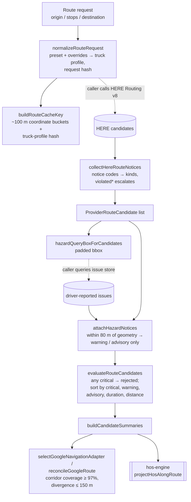

# truck-routing

Truck-aware routing domain logic in TypeScript: request normalization, stable
cache keys, HERE notice-code classification, crowdsourced hazard scoring,
candidate ranking, and HERE-vs-Google corridor reconciliation. Pure functions
plus Zod schemas; no provider HTTP.

## Why this exists

A car router will happily send a 13'6" semi under an 11-foot bridge. The
production fix was to route with HERE's truck profile, but the hard part is
what happens after the provider answers: deciding which of several candidates
is actually safe, folding in what drivers have reported on the ground, caching
without leaking one truck's restrictions into another's route, and checking
that the consumer navigation app the driver follows stays inside the approved
truck corridor. This package is that decision layer, extracted from a
production trucking operations platform.

## Architecture



Key decisions and tradeoffs:

- **Notice codes beat notice text.** `here-notice-codes.ts` maps HERE Routing
  v8's stable notice `code`s (`heightRestriction`,
  `violatedVehicleRestriction`, ...) to notice kinds, stripping the `violated`
  prefix and flagging it so severity can escalate. Keying off the code matters:
  a low-bridge notice whose text never says "height" used to fall through to
  advisory and could let a critical truck route pass. The text heuristic
  remains only as a fallback for unmapped codes.
- **Any critical notice rejects a candidate outright.** Ranking is a strict
  lexicographic comparator (critical, warning, advisory counts, then duration,
  distance, provider order) so it is deterministic and easy to explain to a
  dispatcher. If every candidate is critical, everything is rejected rather
  than picking the least bad.
- **Crowd reports can downrank, never block.** Driver-reported issues (low
  bridge, no-truck road, bad dock approach, ...) within 80 m of a candidate's
  decoded geometry become `crowdsourced_hazard` notices that are at most
  `warning`. Only authoritative HERE restrictions can be `critical`, so one bad
  report cannot strand a load.
- **Cache keys are bucketed but truck-specific.** Coordinates are bucketed to
  three decimals (about 100 m) so near-identical requests share a cache entry,
  while the normalized truck-profile hash (dimensions rounded to sensible
  steps, hazmat classes sorted) keeps a hazmat tanker from reusing a dry van's
  route. `stableStringify` sorts keys so hashes do not depend on object order.
- **Consumer navigation is checked against the truck corridor.** Drivers may
  follow Google turn-by-turn, so `navigation-adapter.ts` and
  `route-reconcile.ts` sample the Google polyline and require 97% of it within
  150 m of the HERE-approved geometry; otherwise the answer is
  `SWITCH_HERE_ONLY`.
- **Provider glue stays outside.** HERE section-signal normalization was pulled
  out of the provider client so it is testable without HTTP; the bbox issue
  lookup is the caller's job (in production a best-effort query that never
  blocks route compute).

### Pairs with hos-engine

The ranked candidate's per-section `durationSeconds` is exactly what
[`hos-engine`](https://github.com/treyktw/hos-engine)'s
`projectHosAlongRoute` takes. Together they answer "which road is legal for
this truck" and "where does this driver have to stop on it".

## Quick start

Requires Node 20.11+ and pnpm 9.

```bash
pnpm install
pnpm test
pnpm typecheck
pnpm demo
```

`pnpm demo` runs [`examples/rank-candidates.ts`](examples/rank-candidates.ts):
three synthetic candidates (the fastest one violates a vehicle restriction,
one crosses a driver-reported no-truck road, one is clean but slowest) go
through notice classification, hazard attachment, and ranking. Output
(abridged):

```text
Cache key: route:v1:here-v8-truck-v3:35.468,-97.516:35.653,-97.478:597d4737776f096d:7a456e07bfb6:4f53cda18c2b

#0 longest-clean                eligible critical=0 warning=0 advisory=1 duration=1900s
#1 middle-with-reported-hazard  eligible critical=0 warning=1 advisory=0 duration=1700s
#2 fastest-under-low-bridge     rejected critical=1 warning=0 advisory=0 duration=1500s (critical_notice)

Section durations to feed hos-engine's projectHosAlongRoute: [ 1900 ]
```

Everything is exported from `src/index.ts`:

```ts
import {
  normalizeRouteRequest,
  collectHereRouteNotices,
  attachHazardNotices,
  evaluateRouteCandidates,
  buildCandidateSummaries,
} from "./src";
```

### What is in `src/`

| File | Responsibility |
| --- | --- |
| `truck-profile.ts`, `routing-policy-preset.ts` | Truck profile schema, normalization, stable hash, presets |
| `route-request.ts` | Request validation (incl. restricted bridge / road avoidance) and normalization |
| `cache-key.ts`, `route-policy.ts` | Stable hashing, cache-key bucketing, TTL and request warnings |
| `here-notice-codes.ts`, `here-notices.ts` | HERE code classification and section-signal normalization |
| `geo.ts`, `polyline.ts` | Point-to-polyline distance, bbox, HERE flexible and Google polyline decoding |
| `hazard-scoring.ts` | Crowdsourced hazard matching against candidate geometry |
| `candidate-ranking.ts` | Candidate evaluation, ranking, summaries |
| `route-issue.ts` | Driver issue reports, destination fingerprints, facility notes |
| `navigation-adapter.ts`, `route-reconcile.ts` | Google-vs-HERE corridor matching |
| `route-response.ts` | Approved route response schema |

## Tests

```bash
pnpm test
pnpm typecheck
```

36 Vitest tests across 10 files, covering cache keys, presets, truck
profiles, issue fingerprints, corridor reconciliation, notice-code
classification, HERE signal normalization, geometry helpers, hazard scoring,
and candidate ranking (safe alternative beats a critically restricted primary,
all-critical rejects everything, a crowd hazard downranks without blocking).
The HERE-signal tests were ported from the provider-client tests: same section
payloads, exercised against the pure normalizer instead of a stubbed fetch.

## What was left out

Provider HTTP clients (request building, API keys, fetch, error mapping); the
route service's cache, persistence, request dedupe, and issue-store lookup
(only its pure ranking and hazard-merge decisions are included); auth and
service HTTP routes; queueing and deployment config; and private operational
rules outside the routing domain. All coordinates and issues in tests and the
demo are synthetic.


## License

MIT. See [LICENSE](LICENSE).
